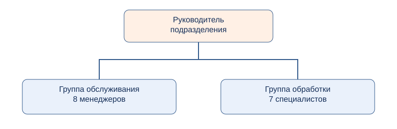

# Проектирование ИС — BANKFLOW
Ступина М. В. / Барашко Е. Н. · ДГТУ, ВОЗПИ-31

**Статус:** учебный проект, тема подлежит согласованию; реальные скриншоты аналогов добавить.

## Введение
Вымышленное банковское подразделение принимает обращения клиентов по картам, вкладам, кредитам, инвестициям и цифровым сервисам. Цель — единый реестр, сокращение ручного поиска, контроль нагрузки и сроков. Система не проводит банковские операции и не использует реальные персональные данные.

## 1. Анализ предметной области
В условном подразделении 1 руководитель, 8 менеджеров и 7 специалистов. Численность выбрана для учебной модели, а не описывает реальный банк. Учет обращений до внедрения ведется в разрозненных списках. Задачи: сократить повторный ввод, устранить потерю назначений, получить сопоставимые показатели сроков.

## 1.1 Сравнительный анализ программных продуктов (ЛР1)
Сравнение по 5 критериям, по публичной документации, не по результатам самостоятельного тестирования.

| Критерий | Jira Service Management | GLPI | Zammad | BANKFLOW (цель) |
|---|---|---|---|---|
| Регистрация обращений | Портал, email, API | Инциденты и запросы | Helpdesk, tickets | Ввод заявки |
| Назначение | Очереди, исполнители | Группы и ответственные | Маршрутизация командам | Ответственный сотрудник |
| Контроль процесса | Workflow, SLA | Статус, приоритет | Чек-листы, история | Статус, время |
| Аналитика | Отчёты и метрики | Dashboards, статистика | Отчётность (сверить редакцию) | Группировка и графики |
| Область применения | ITSM, сервисные команды | ITSM, активы | Поддержка клиентов | Учебный банковский реестр |

Источники: https://support.atlassian.com/jira-service-management-cloud/docs/get-to-know-the-main-jira-service-management-features/ ; https://www.glpi-project.org/en/features/ ; https://zammad.com/en/product/features . Скриншоты оригинальных интерфейсов и проверка актуальных редакций — обязательный оставшийся шаг для ЛР1.

Функции: поиск клиентов, учёт продуктов, регистрация обращений, распределение задач, аналитика. Ограничения: только учебные данные, локальная демонстрация, нет финансовых транзакций, нет промышленной авторизации.

## 1.2 Структура организации (ЛР2)
Организационная схема до внедрения: руководитель подразделения → две параллельные группы: обслуживание (8 менеджеров) и обработка (7 специалистов). В исходной схеме нет ещё не существующей ИС или IT-отдела. До внедрения данные хранятся в отдельных списках, обращения передаются вручную. После внедрения — единый реестр.

| Сотрудник | Функции до внедрения | Функции, которые автоматизируются |
|---|---|---|
| Менеджер | Поиск клиента, запись заявки, передача | Поиск по реестру, создание заявки, выбор продукта и исполнителя |
| Специалист | Получение задания, фиксация результата | Просмотр очереди, фильтрация, изменение статуса |
| Руководитель | Сбор сведений из списков | Сводные показатели, контроль нагрузки и сроков |

### 1.2.1 Функциональные подсистемы
**Таблица 2. Оперативный уровень**

| Подсистема | Вход | Функция | Выход |
|---|---|---|---|
| Клиентский реестр | Идентификатор, имя, город | Поиск и фильтр | Карточка клиента |
| Обращения | Клиент, продукт, исполнитель, приоритет | Регистрация и смена статуса | Запись обращения |
| Справочники | Идентификатор продукта или сотрудника | Выбор существующей записи | Ссылка на справочник |

**Таблица 3. Тактический уровень**

| Подсистема | Вход | Функция | Выход |
|---|---|---|---|
| Очередь | Реестр обращений | Фильтр по статусу, контроль исполнения | Список задач |
| Распределение | Сотрудники, новые обращения | Назначение ответственного при регистрации | Очередь сотрудника |
| Контроль | Даты, статусы, приоритет | Выявление незакрытых и срочных заявок | Сводка для руководителя |

**Таблица 4. Стратегический уровень**

| Подсистема | Вход | Функция | Выход |
|---|---|---|---|
| Аналитика | Учебный набор обращений | Статистика и группировка по категориям | Графики и показатели |
| Планирование | Сводка нагрузки и длительности | Оценка потребности в ресурсах | Решения о распределении нагрузки |
| Качество | Результаты проверок | Контроль выполнения требований | Протокол и план улучшений |

Часть тактических и стратегических функций является проектным требованием; фактическая реализация и ограничения приведены в разделе 2.4.

### 1.2.2 Обеспечивающие подсистемы

| Вид обеспечения | Назначение в BANKFLOW |
|---|---|
| Информационное | Таблицы, связи, синтетические данные, словарь полей |
| Программное | Браузер, Python/SQLite, отдельные MySQL/Node-модули |
| Техническое | ПК с Python, планшет с браузером, доверенная сеть |
| Технологическое | Регламент регистрации, назначение, обработка, закрытие заявки |
| Математическое | Фильтрация, агрегаты, статистика длительности |
| Организационное | Роли, ответственность, инструкции, порядок передачи |
| Юридическое | Запрет реальных банковских данных; независимый учебный прототип |
| Лингвистическое | Русский интерфейс, единые термины, справочники статусов |

## 2. Техническое задание (ЛР3)
### 2.1 Общие сведения
Название: BANKFLOW; заказчик и исполнитель — учебные роли.
### 2.2 Назначение и цели
Единый демонстрационный интерфейс, семь дисциплин, реестр обращений и анализ.
### 2.3 Объект автоматизации
Работа с обращениями условного подразделения; роли менеджера, специалиста, руководителя.
### 2.4 Требования
Функциональные требования: F1 — поиск и фильтрация клиентов; F2 — регистрация обращения по существующим клиенту, продукту и сотруднику; F3 — изменение статуса и фильтр реестра; F4 — экспорт реестра в CSV; F5 — анализ фиксированного учебного датасета. Нефункциональные: N1 — автономная демонстрация, N2 — адаптивный интерфейс, N3 — проверка связей и допустимых значений на сервере, N4 — только синтетические данные. Веб-демо хранит изменения в браузере; локальный режим пишет в SQLite. Аналитика ИИС использует отдельный фиксированный снимок для воспроизводимости. Прогнозирование и промышленная авторизация вне объема прототипа.
### 2.5 Состав работ
Анализ, модель данных, интерфейс, API, тестирование, отчёты.
### 2.6 Контроль и приёмка
Критерии приемки: 7 разделов открываются; поиск по имени возвращает совпадения; заявка получает уникальный ID и статус «Новое»; смена статуса сохраняется после обновления; неизвестный внешний ключ отклоняется; CSV содержит выбранные записи; исходный датасет очищается до 360 уникальных строк; автономная демонстрация открывается без сети после кэширования. MySQL и Express проверяются отдельно в своих средах. Результаты тестов и ограничения — tests/verification.txt.
### 2.7 Подготовка объекта
Установить Python для серверного режима, MySQL для ИСиТ, Node.js для Express; подготовить демонстрационные данные.
### 2.8 Документирование
README, исходники, схема данных, отдельные комплекты и отчёты.
### 2.9 Источники
Методические указания ЛР1–3, Telegram 14.10.2026; официальная документация аналогов выше.
