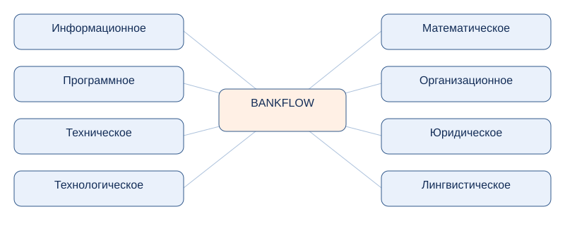

# Проектирование ИС — BANKFLOW
Ступина М. В. / Барашко Е. Н. · ДГТУ, ВОЗПИ-31

**Статус:** учебный проект, тема подлежит согласованию; реальные скриншоты аналогов добавить.

## Введение
Вымышленное банковское подразделение принимает обращения клиентов по картам, вкладам, кредитам, инвестициям и цифровым сервисам. Цель — единый реестр, сокращение ручного поиска, контроль нагрузки и сроков. Система не проводит банковские операции и не использует реальные персональные данные.

## 1. Анализ предметной области
В условном подразделении 1 руководитель, 8 менеджеров и 7 специалистов. Численность выбрана для учебной модели, а не описывает реальный банк. Учет обращений до внедрения ведется в разрозненных списках. Задачи: сократить повторный ввод, устранить потерю назначений, получить сопоставимые показатели сроков.

## 1.1 Сравнительный анализ программных продуктов (ЛР1)
Сравнение по 5 критериям, по публичной документации, не по результатам самостоятельного тестирования.

| Критерий | Jira Service Management | GLPI | Zammad | BANKFLOW (цель) |
|---|---|---|---|---|
| Регистрация обращений | Портал, email, API | Инциденты и запросы | Helpdesk, tickets | Ввод заявки |
| Назначение | Очереди, исполнители | Группы и ответственные | Маршрутизация командам | Ответственный сотрудник |
| Контроль процесса | Workflow, SLA | Статус, приоритет | Чек-листы, история | Статус, время |
| Аналитика | Отчёты и метрики | Dashboards, статистика | Отчётность (сверить редакцию) | Группировка и графики |
| Область применения | ITSM, сервисные команды | ITSM, активы | Поддержка клиентов | Учебный банковский реестр |

Источники: https://support.atlassian.com/jira-service-management-cloud/docs/get-to-know-the-main-jira-service-management-features/ ; https://www.glpi-project.org/en/features/ ; https://zammad.com/en/product/features . Скриншоты оригинальных интерфейсов и проверка актуальных редакций — обязательный оставшийся шаг для ЛР1.

Функции: поиск клиентов, учёт продуктов, регистрация обращений, распределение задач, аналитика. Ограничения: только учебные данные, локальная демонстрация, нет финансовых транзакций, нет промышленной авторизации.

## 1.2 Структура организации (ЛР2)
Организационная схема до внедрения: руководитель подразделения → две параллельные группы: обслуживание (8 менеджеров) и обработка (7 специалистов). В исходной схеме нет ещё не существующей ИС или IT-отдела. До внедрения данные хранятся в отдельных списках, обращения передаются вручную. После внедрения — единый реестр.

| Сотрудник | Функции до внедрения | Функции, которые автоматизируются |
|---|---|---|
| Менеджер | Поиск клиента, запись заявки, передача | Поиск по реестру, создание заявки, выбор продукта и исполнителя |
| Специалист | Получение задания, фиксация результата | Просмотр очереди, фильтрация, изменение статуса |
| Руководитель | Сбор сведений из списков | Сводные показатели, контроль нагрузки и сроков |

### 1.2.1 Функциональные подсистемы
**Таблица 2. Оперативный уровень**

| Подсистема | Вход | Функция | Выход |
|---|---|---|---|
| Клиентский реестр | Идентификатор, имя, город | Поиск и фильтр | Карточка клиента |
| Обращения | Клиент, продукт, исполнитель, приоритет | Регистрация и смена статуса | Запись обращения |
| Справочники | Идентификатор продукта или сотрудника | Выбор существующей записи | Ссылка на справочник |

**Таблица 3. Тактический уровень**

| Подсистема | Вход | Функция | Выход |
|---|---|---|---|
| Очередь | Реестр обращений | Фильтр по статусу, контроль исполнения | Список задач |
| Распределение | Сотрудники, новые обращения | Назначение ответственного при регистрации | Очередь сотрудника |
| Контроль | Даты, статусы, приоритет | Выявление незакрытых и срочных заявок | Сводка для руководителя |

**Таблица 4. Стратегический уровень**

| Подсистема | Вход | Функция | Выход |
|---|---|---|---|
| Аналитика | Учебный набор обращений | Статистика и группировка по категориям | Графики и показатели |
| Планирование | Сводка нагрузки и длительности | Оценка потребности в ресурсах | Решения о распределении нагрузки |
| Качество | Результаты проверок | Контроль выполнения требований | Протокол и план улучшений |

Часть тактических и стратегических функций является проектным требованием; фактическая реализация и ограничения приведены в разделе 2.4.

### 1.2.2 Обеспечивающие подсистемы

| Вид обеспечения | Назначение в BANKFLOW |
|---|---|
| Информационное | Таблицы, связи, синтетические данные, словарь полей |
| Программное | Браузер, Python/SQLite, отдельные MySQL/Node-модули |
| Техническое | ПК с Python, планшет с браузером, доверенная сеть |
| Технологическое | Регламент регистрации, назначение, обработка, закрытие заявки |
| Математическое | Фильтрация, агрегаты, статистика длительности |
| Организационное | Роли, ответственность, инструкции, порядок передачи |
| Юридическое | Запрет реальных банковских данных; независимый учебный прототип |
| Лингвистическое | Русский интерфейс, единые термины, справочники статусов |

## 2. Техническое задание (ЛР3)
Настоящее ТЗ определяет требования к учебной ИС BANKFLOW. Структура воспроизводит пункты исходных указаний ЛР3. Сроки, показатели и роли ниже — проектные решения, а не утверждённое преподавателем задание.

### 2.1 Общие сведения
#### 2.1.1 Полное наименование системы и её условное обозначение
Информационная система управления обращениями клиентов условного банковского подразделения. Условное обозначение: ИС BANKFLOW.
#### 2.1.2 Наименование разработчика системы и реквизиты заказчика
Разработчик — студент группы ВОЗПИ-31 ДГТУ. Заказчик — условное учебное подразделение; реального банковского заказчика нет.
#### 2.1.3 Основания для разработки АС
Учебное задание по проектированию ИС (ЛР1–3). Проект предназначен для обработки сведений о вымышленных обращениях; тема курсовой и применение материалов в ней подлежат согласованию.
#### 2.1.4 Плановые сроки начала и окончания работ
Учебный горизонт — осенний семестр 2026 года. Условный план разработки рассчитан на 25 рабочих дней (см. модуль стандартизации). Конкретные календарные даты сдачи не установлены.
#### 2.1.5 Нормативно-технические документы и методические материалы
Исходные указания ЛР3 приводят ГОСТ 19.201-78, ГОСТ 34.601-90, ГОСТ 34.201-89 и РД 50-34.698-90 как учебные образцы. Они перечислены здесь именно как ссылки методички; актуальные редакции и обязательность применения в 2026 году отдельно не установлены. Проект не заявляет сертификацию или соответствие действующим банковским требованиям.

### 2.2 Назначение и цели создания системы
#### 2.2.1 Назначение системы
ИС BANKFLOW предназначена для ведения единого реестра клиентов, справочников сотрудников и продуктов, регистрации обращений, распределения задач и анализа учебной выборки.
#### 2.2.2 Цели создания системы
Обеспечить единообразную регистрацию обращений; уменьшить ручной поиск; сохранить связи записей; обеспечить демонстрацию статусов и сводной аналитики. Эффект измеряется успешным выполнением тестовых сценариев, а не неподтверждённой экономией реального банка.

### 2.3 Характеристика объекта автоматизации
#### 2.3.1 Краткие сведения об объекте автоматизации
Условное подразделение: руководитель, 8 менеджеров, 7 специалистов. Процессы до внедрения: приём, поиск по спискам, ручное распределение, фиксация результата. После внедрения — единый реестр и очередь задач.
#### 2.3.2 Условия эксплуатации объекта автоматизации
Учебный компьютер с браузером и Python 3.10+; планшет для просмотра. Локальный сервер по умолчанию доступен только на самом ПК; подключение планшета допускается в доверенной локальной сети. Публичная версия демонстрирует синтетические данные и сохраняет изменения только в браузере. Реальная авторизация, банковские интеграции и обработка платежей не входят в проект.

### 2.4 Требования к системе
#### 2.4.1 Требования к системе в целом
##### 2.4.1.1 Структура и функционирование системы
##### 2.4.1.1.1 Перечень подсистем, их назначение и основные характеристики
Оперативный уровень: клиентский реестр (поиск и карточка), обращения (создание и смена статуса), справочники (идентификаторы и категории). Тактический: очередь, назначение исполнителя при регистрации, фильтры и контроль незакрытых задач. Стратегический: анализ фиксированного датасета, оценка нагрузки как проектная функция и контроль качества. Обеспечение соответствует восьми видам раздела 1.2.2. Не все стратегические функции реализованы; планирование ресурсов и промышленное управление качеством являются перспективой.
##### 2.4.1.2 Связь и обмен между компонентами
Локальный интерфейс использует HTTP/JSON для API SQLite. Автономная сборка содержит встроенный снимок. Данные ИИС передаются в CSV. Обязательной интеграции с внешним банком нет.
##### 2.4.1.3 Взаимосвязи со смежными системами
Требования не предъявляются; никаких подключений к банковским информационным системам. MySQL и Express являются отдельными учебными средами.
##### 2.4.1.4 Режимы функционирования
Нормальный режим: работа локального сервера и браузера. Демонстрационный режим: локальный HTML либо опубликованный статический интерфейс; поиск по снимку, записи в браузер. При отказе API система сообщает об ошибке, не выдаёт несохранённую операцию за сохранённую.
##### 2.4.1.5 Диагностирование
GET /api/health определяет доступность SQLite; сервер возвращает коды HTTP 400, 404 и 500 при ошибках; тесты проверяют создание, изменение, сохранение и целостность связей. Ошибки в браузере отображаются сообщениями.
##### 2.4.1.6 Развитие и модернизация
Модульная структура, независимые учебные комплекты, отдельные исходники и сборка. В перспективе — авторизация, серверная аналитика, миграция на промышленную СУБД; эти функции не входят в реализованный прототип.
##### 2.4.1.7 Численность и квалификация персонала
Три учебные роли: менеджер, специалист, руководитель. Пользователь должен уметь работать с браузером; запуск серверного режима выполняется студентом по README. Права ролей описывают предметную область, а не фактически реализованную авторизацию.
##### 2.4.1.8 Показатели назначения
60 условных клиентов, 15 сотрудников исполнительских групп (8 менеджеров и 7 специалистов; руководитель описан в оргструктуре), 15 продуктов, исходный рабочий реестр 360 обращений. Система должна поддерживать поиск по имени, городу и сегменту, запись новой заявки с уникальным ID, изменение статуса, экспорт CSV. Эти значения — параметры учебного стенда, не производственный норматив.
##### 2.4.1.9 Надёжность
Транзакционное сохранение SQLite, контроль внешних ключей и допустимых значений, воспроизводимые исходные данные. Для промышленного SLA и расчёта вероятности отказа исходных испытаний нет; они не заявляются. Регрессионные проверки приведены в tests/verification.txt.
##### 2.4.1.10 Безопасность
Только синтетические данные; запрет настоящих банковских сведений и секретов. Локальный API не имеет промышленной авторизации, поэтому не публикуется в открытой сети. Запросы записи с чужого Origin отклоняются; параметризованные запросы используются для пользовательских значений.
##### 2.4.1.11 Сохранность информации при авариях
Учебный снимок восстанавливается из seed.sql; рабочую SQLite-БД резервируют при остановленном сервере. Отметки готовности экспортируются в JSON. Сохранность записей браузера зависит от доступности локального хранилища; удаление данных браузера может удалить изменения.
##### 2.4.1.12 Эргономика и техническая эстетика
Адаптивный графический интерфейс; единые подписи, визуальные статусы, выбор дисциплины и лабораторной, доступ к коду и архивам. Цветовая гамма белая, синяя, оранжевая; официальный банковский логотип не используется. Для мобильного экрана предусмотрена прокрутка широких таблиц.
#### 2.4.2 Требования к функциям (задачам), выполняемым системой
| Код | Функция | Проверяемый результат |
|---|---|---|
| F1 | Поиск клиентов | «Орлова» возвращает совпадения; несуществующее имя — пустой список |
| F2 | Регистрация обращения | Выбранные существующие клиент, сотрудник и продукт; уникальный ID и статус «Новое» |
| F3 | Обработка и фильтрация | Статус сохраняется после обновления; реестр фильтруется по статусу |
| F4 | Выгрузка | CSV содержит отображаемые после фильтрации записи |
| F5 | Аналитика ИИС | 361 исходная строка, 360 очищенных в основной стратегии, 9 полей; воспроизводимые графики |
| F6 | Учебные модули | Семь разделов, исходники и отдельные архивы для проверки |
#### 2.4.3 Требования к видам обеспечения
##### 2.4.3.1 Математическое обеспечение
Фильтрация, агрегирование, описательная статистика длительности, контроль допустимого диапазона. Предсказательная модель не требуется для ЛР1 ИИС.
##### 2.4.3.2 Информационное обеспечение
Реляционные таблицы клиентов, сотрудников, продуктов и обращений; первичные и внешние ключи; синтетические CSV и SQL. Аналитический снимок отделён от редактируемого рабочего реестра.
##### 2.4.3.3 Лингвистическое обеспечение
Русские подписи и сообщения, единые названия статусов и категорий; UTF-8 для файлов, интерфейса и JSON.
##### 2.4.3.4 Программное обеспечение
HTML, CSS, JavaScript; Python 3.10+ и SQLite для локального API; pandas/matplotlib для ИИС; MySQL 8 и Node.js/Express отдельно для соответствующих лабораторных. В исходной методичке номер программного обеспечения повторяет 2.4.3.1; здесь нумерация последовательная.

### 2.5 Состав и содержание работ по созданию системы
Анализ предметной области и аналогов; формирование требований; структура данных; прототип интерфейса; программирование API; испытания; отчётность и демонстрация. Календарный план, оперограмма и сетевой график находятся в модуле стандартизации.
### 2.6 Порядок контроля и приёмки системы
#### 2.6.1 Виды, состав, объём и методы испытаний
Функциональные, негативные и регрессионные проверки F1–F6, проверка связей SQLite, мобильная компоновка, загрузка архивов, воспроизводимость Python. Критерии: ожидаемые результаты таблицы F1–F6, сохранённые записи после перезапуска, отклонение несуществующих ключей и неверных статусов. Представляются отчёт, демонстрационные материалы и исходники. Результаты фактических проверок и ограничения — tests/verification.txt; MySQL и Express проверяются в своих средах. Приёмка преподавателем не проводилась.
### 2.7 Подготовка объекта автоматизации к вводу в действие
В учебном режиме: распаковать проект или открыть статическую сборку; для SQLite установить Python и выполнить запуск согласно README. Проверить доступность интерфейса, использовать только учебные файлы. Промышленное внедрение не предусмотрено.
### 2.8 Требования к документированию
Единый документ проектирования с введением, главой 1 и главой 2, схемами, сравнительной таблицей; README, схема данных, исходники, протокол испытаний, отдельные комплекты дисциплин. Формат итогового отчёта — по указаниям преподавателя (содержание, рамки и штампы, Times New Roman 14, межстрочный интервал 1,5). Настоящий Markdown — структурированный черновик, не оформленный по рамкам отчёт.
### 2.9 Источники
1. Указания к выполнению лабораторных работ № 1–3 по проектированию ИС (материалы группы 14.10.2026).
2. ГОСТ 19.201-78; ГОСТ 34.601-90; ГОСТ 34.201-89; РД 50-34.698-90 — обозначения, приведённые в учебном образце ЛР3.
3. Документация аналогов: ссылки в разделе 1.1.
4. Исходники BANKFLOW, docs/ARCHITECTURE.md, tests/verification.txt.
